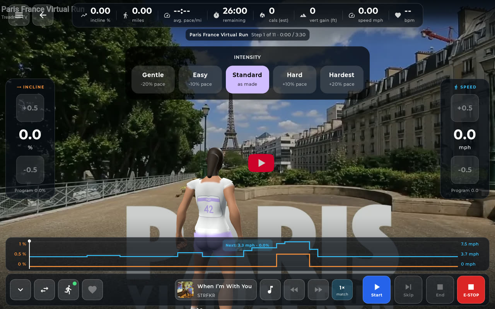
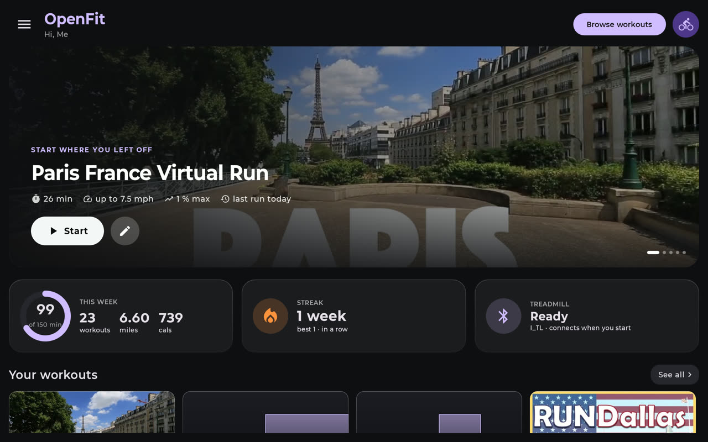
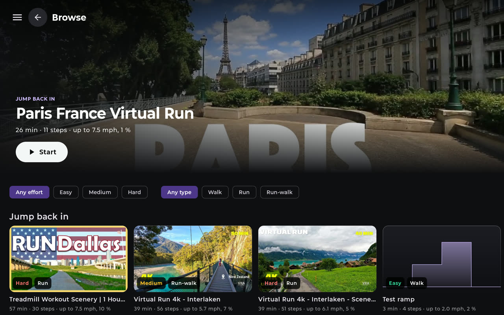
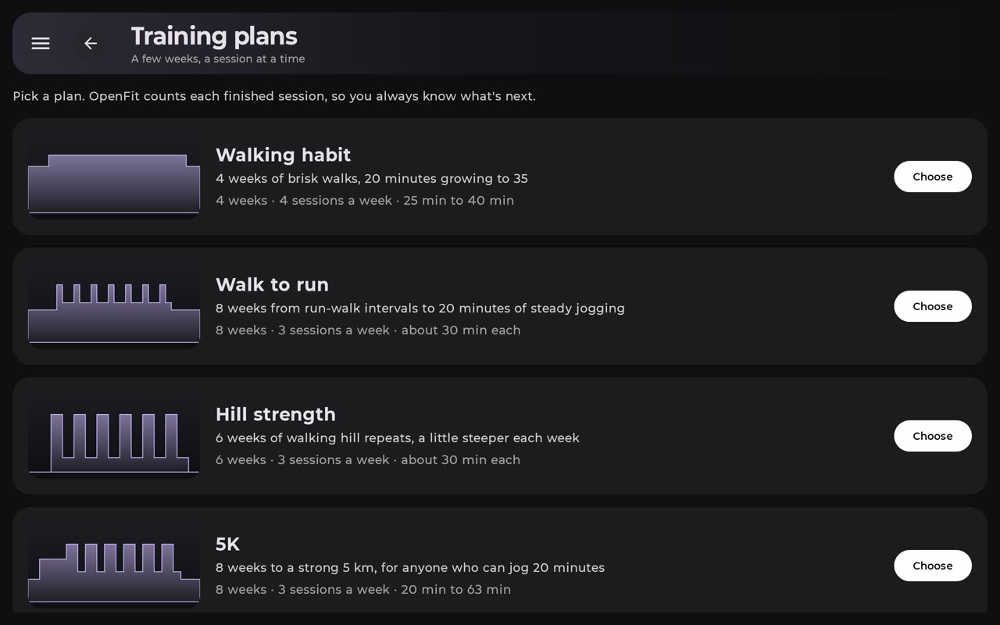
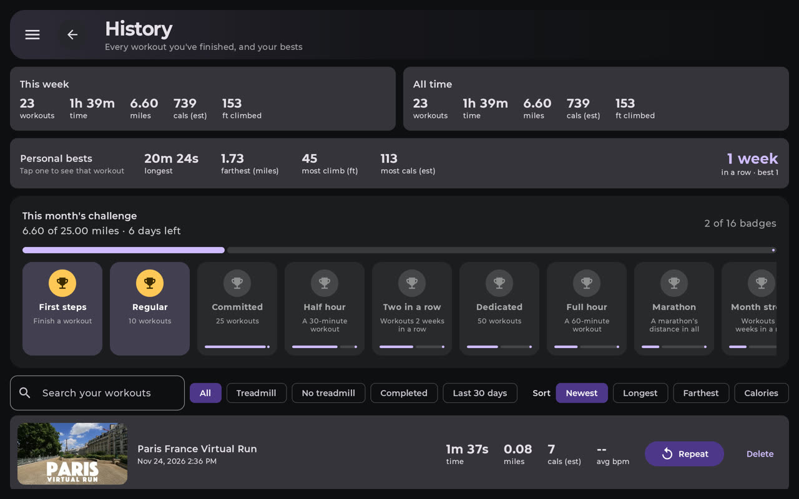
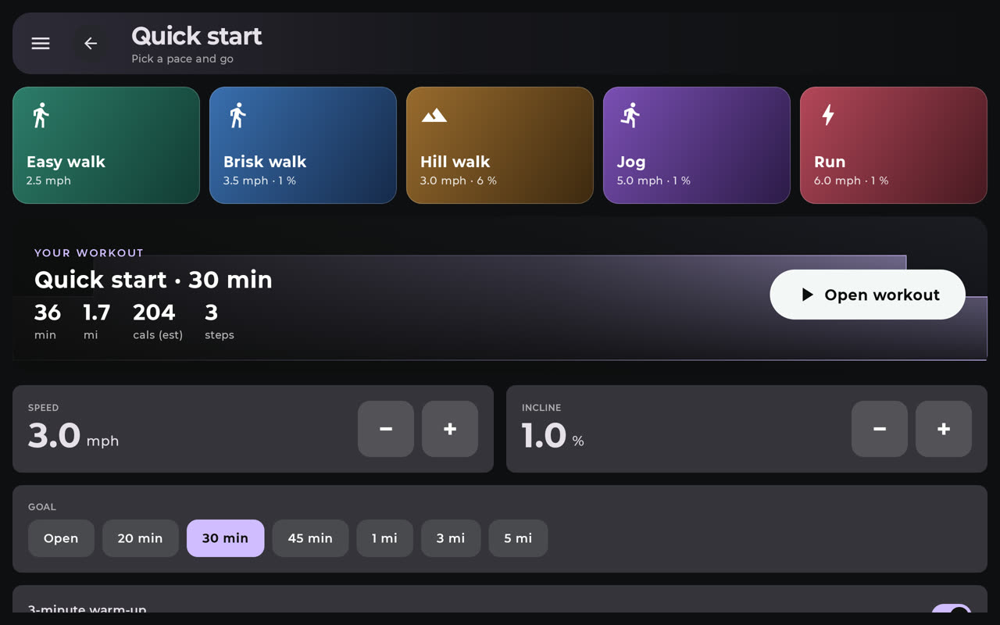
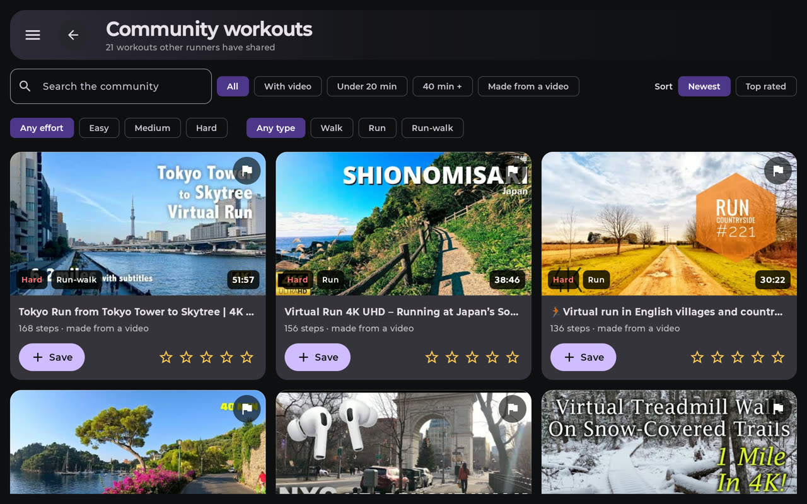
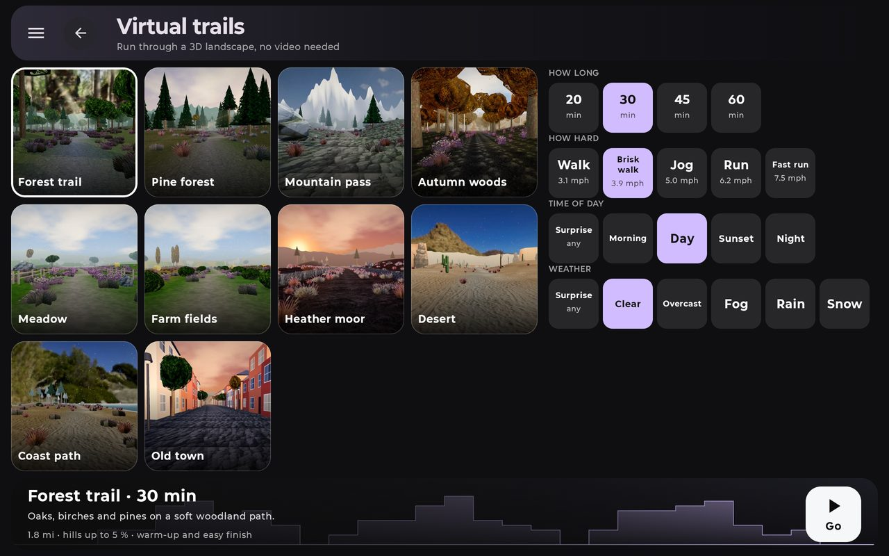
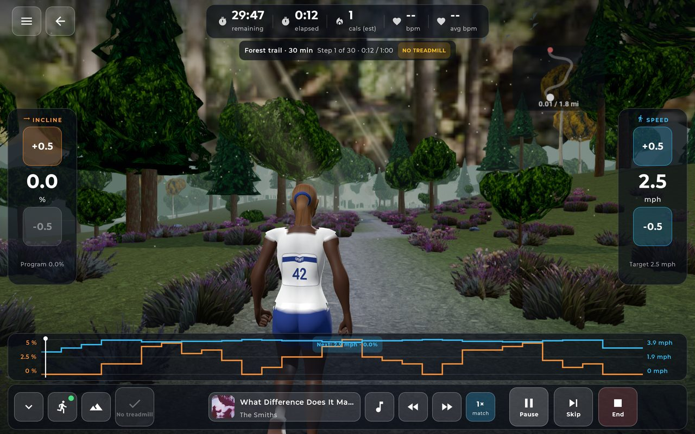
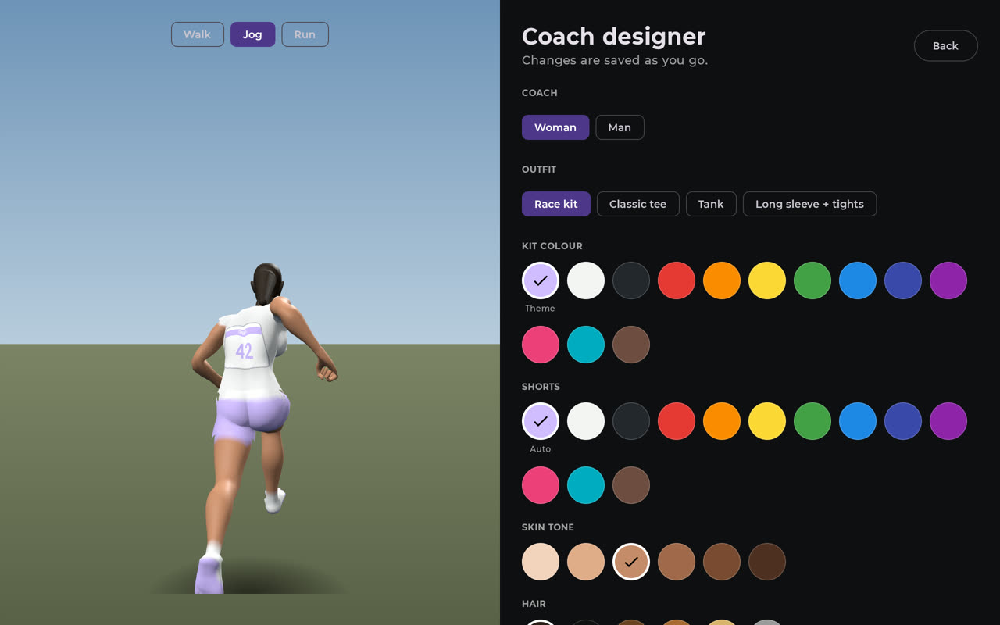

# OpenFit

**Free, open-source treadmill control for Android tablets.** Run scenic video workouts, training plans
and your own programs on a compatible treadmill over Bluetooth, with a virtual coach, heart-rate zones
and no subscription, no account and no ads.

> 🎬 **Launch video:** coming soon.
>
> 💬 **Community:** questions, workouts and ideas on [r/OpenFitHome](https://www.reddit.com/r/OpenFitHome).

## What's new

- **Virtual trails.** No video needed: run through a 3D landscape (forest, pine forest, mountain pass,
  autumn woods, meadow, farm fields, heather moor, desert, coast path or old town) at the time of day and
  in the weather you pick, with hills that suit the landscape, a trail map and the coach alongside. The
  cool-down carries on along the same trail.
- **Change the scenery as you run.** A scenery button beside the coach button switches the landscape,
  time of day and weather without leaving the workout. Pick a trail, length, effort, time and weather
  on one screen, play any starter workout straight from Home, and see the speed and incline profile in
  No treadmill mode too.
- **Cool-down inside the video.** A video workout's last ten minutes are its cool-down, and ending
  early carries the cool-down on in the video instead of switching to a drawn path.
- **GPX routes on the map.** A workout made from a GPX file shows its real route on the trail map.
- **Updates you approve.** OpenFit checks for a new version and asks first, never during a workout.
- **Coach.** Its own volume and mute, captions you can turn on or off, natural voices, names, and saved
  coaches to pick from.

OpenFit talks to the treadmill console over Bluetooth Low Energy, runs speed-and-incline workouts
(including ones made from YouTube scenery videos), and shows a full-screen workout display over the
video. It was built and tested on a NordicTrack T 6.5 (console `I_TL`); other iFit-compatible consoles
may need work (see [Adding a treadmill](android/docs/adding-a-treadmill.md)).

## What it does

**Workouts**
- **Scenic video runs.** Any YouTube walking or running video becomes a workout: AI reads the video's
  pace and hills and builds the speed and incline steps. "Match my speed" plays the video faster or
  slower with the belt, and a 3-2-1 countdown starts it together.
- **Virtual trails.** Ten 3D landscapes to run through without a video, each with its own trees,
  ground and sky, from morning to night and from clear to snow. Hills follow the workout's incline and
  the trail moves at your speed.
- **Virtual coach.** A 3D runner on screen paces you, checks in every minute, calls out changes and tells
  you about the place you're running through. Design your own in the coach designer.
- **Training plans.** Walking habit, Walk to run, Hill strength, and 5K, 10K, half-marathon and marathon
  plans, on the days you choose, with a reminder and a "Today's session" card on Home.
- **Intensity.** Any workout, video ones included, at Gentle, Easy, Standard, Hard or Hardest. Each
  profile remembers its level, and "Too easy" or "Too hard" after a run suggests the next one.
- **Quick start, editor and routes.** One-tap presets; a visual timeline editor; import a GPX route
  and its hills become the incline.
- **Pick up where you left off** if the app is closed mid-workout.

**Progress**
- History with charts, personal bests, streaks, 16 achievement badges and a monthly distance challenge.
- Heart rate from any standard Bluetooth strap or watch, with zones, time in zone and calories.
- Rate each workout; export TCX; send workouts to Health Connect (Fitbit, Google Fit and others).

**Community**
- A community library of shared workouts, with ratings, filters and a pre-scanned set of scenery runs.
- Sharing is moderated automatically (word filter, YouTube safety check, reports), with no one to approve.

**Safety and privacy**
- Every command is checked against the machine's own limits and your ceilings. Stop and E-STOP are always
  one tap away, and ending a workout starts a cool-down.
- OpenFit connects only while a workout runs and lets go when idle, so the console's own buttons keep working.
- Local profiles, no sign-in. Your keys stay encrypted on the tablet. Backups to a file or Google's Android backup.
- **No treadmill yet?** Turn on **No treadmill** in Devices to run workouts on screen only.

## Screenshots

| | |
|---|---|
|  |  |
| **Home** | **Browse** |
|  |  |
| **Training plans** | **History and achievements** |
|  |  |
| **Quick start** | **Community** |
|  |  |
| **Virtual trails** | **On a virtual trail** |
|  | |
| **Coach designer** | |

## Get started

1. Download `OpenFit-<version>.apk` from the [latest release](../../releases/latest) and install it on an
   Android tablet (Android 9 or later; a 10-inch or larger landscape tablet works best). Android asks you
   to allow installs from your browser or file manager the first time.
2. Clip on the treadmill's safety key, open OpenFit and tap **Devices** to find the console. No pairing is
   needed.
3. Pick a workout on **Home** or **Browse** and tap **Start**.

## No ads

OpenFit never shows ads and never will: an ad popping up while you are on a moving belt is a distraction
you should not have to deal with. Two honest caveats about YouTube videos:

- YouTube's own player may show YouTube's ads on some videos. OpenFit cannot hide or skip them without
  breaking YouTube's terms, so it does not try.
- An ad can never change your workout. When the video stops moving (an ad, or loading), the workout holds:
  speed and incline stay as they are and no step changes until the video is back, so the program stays in
  step with the picture. A hold ends by itself after 2 minutes if the video never comes back.

For a workout with no ads at all, use a video file on the tablet, or no video.

## Use your own Gemini key (optional, free)

Making a workout from a new YouTube video uses Google's Gemini model, on your own key (Google's free tier
covers normal use). Workouts, facts and landmarks others have already made, including a pre-scanned library
of scenery videos, are free without a key.

1. Open **[Google AI Studio → API keys](https://aistudio.google.com/app/apikey)** and sign in with your
   Google account.
2. Tap **Create API key** (pick the default project if asked) and copy the key. It starts with `AIza`.
3. In OpenFit, open the menu → **Keys & services**, paste it and tap **Save key**.

The key is stored encrypted on the tablet (Android Keystore). Keep it private, and delete it in AI Studio
any time.

## No server needed

OpenFit works without any server. In **Keys & services**, turn off **Use the OpenFit server**:

- Video-to-workout and the coach's facts and landmarks run on the tablet with your own Gemini key, which
  then goes only to Google.
- Video search and a video's length use YouTube's API: turn on **YouTube Data API v3** for your Gemini key's
  Google Cloud project, or add a separate YouTube key.
- The community library and AI results already made by others are read straight from this repository's
  [`community/`](community/) folder, so videos someone has analysed before cost nothing.
- Sharing and rating workouts need a server, so they are off in this mode. You can host your own copy of
  `backend/` (see `backend/.env.example`).

## Repository layout

| Path | What it is |
|------|------------|
| `android/protocol` | The console protocol as a plain JVM library, with tests. |
| `android/transport` | Android Bluetooth links (treadmill, heart-rate strap). |
| `android/app` | The Android app (Jetpack Compose). |
| `android/specs` | Feature specs. |
| `backend/` | Vercel functions for video search, video-to-workout and the community library (optional). |
| `community/` | Shared workouts and cached AI results, as JSON; readable by anyone. |
| `docs/screenshots/` | The screenshots on this page. |

## Building

`android/` is a Gradle project: `gradle :protocol:test :app:assembleDebug`. The backend needs its own
keys in `backend/.env.local` (see `.env.example`); none are included. Running your own backend? Put its
address in **Keys & services → Server address**.

More: [DEVELOPMENT.md](DEVELOPMENT.md) (layout, build, rules), [CONTRIBUTING.md](CONTRIBUTING.md), and
[Adding a treadmill](android/docs/adding-a-treadmill.md).

## Works with

| Machine | Console | Status |
|---------|---------|--------|
| NordicTrack T 6.5 | `I_TL` | Tested: speed, incline, stop, heart rate |
| Other iFit-compatible treadmills | various | Untested; may need a console name or unlock tweak. Reports welcome. |

### 🙋 Help test other treadmills

OpenFit has only been tested on one machine so far. **If you have another iFit-compatible treadmill
(NordicTrack, ProForm and similar), you can help bring it to everyone**, even without writing code:

1. Install OpenFit and open **Devices**. Does your console show up, and under what name?
2. Standing beside the belt with the safety key on, follow the checks in
   [Adding a treadmill](android/docs/adding-a-treadmill.md): stop, speed, incline, a short workout.
3. [Open an issue](../../issues/new) with your machine's model, the console name, and what worked
   and what didn't. Bluetooth captures help a lot (remove serial numbers first).

Developers: the protocol lives in `android/protocol` with unit tests, so most of the work can be done
on a desktop. See [CONTRIBUTING.md](CONTRIBUTING.md). Every machine that works gets added to the table
above.

## Safety

> **Read [DISCLAIMER.md](DISCLAIMER.md) before using OpenFit.** You use it at your own risk; it is not a
> medical device and is not affiliated with iFit or any manufacturer.

A treadmill can hurt you. OpenFit checks every command against the machine's limits and your ceilings, but
software fails: always use the safety key and know where the console's own STOP button is. You use this at
your own risk; see the warranty disclaimer in the licence.

## Not affiliated, and trademarks

OpenFit is an independent project. It is not made, endorsed or supported by iFit, NordicTrack or ProForm.
Those names are trademarks of their owners and are used here only to say which machines OpenFit works with.
No iFit code, apps or content are included in this repository.

iFIT, NordicTrack and ProForm are trademarks of their owner; Bluetooth® is a registered trademark of
Bluetooth SIG, Inc.; YouTube and Android are trademarks of Google LLC; other names are trademarks of
their respective owners. They are used only to describe compatibility. See [DISCLAIMER.md](DISCLAIMER.md).

## Support OpenFit

OpenFit is free and has no ads. If it helps your training, donations keep it going:

- **Bitcoin:** `bc1qh82ncrxc0pjszjugmk29gpyswnd0cfsklwr800`
- **Ethereum:** `0x16979A3283Ff840C2dD12Ea30d0e40a9508f81DA`

The same addresses are in the app under **About & legal**.

## Licence

OpenFit is free software: you can redistribute it and/or modify it under the terms of the GNU General
Public License as published by the Free Software Foundation, version 3 or (at your option) any later
version. See [LICENSE](LICENSE).

Layout ideas for the profile picker and the browse screen were taken from
[NuvioMobile](https://github.com/NuvioMedia/NuvioMobile) (GPL-3.0); no code was copied.
